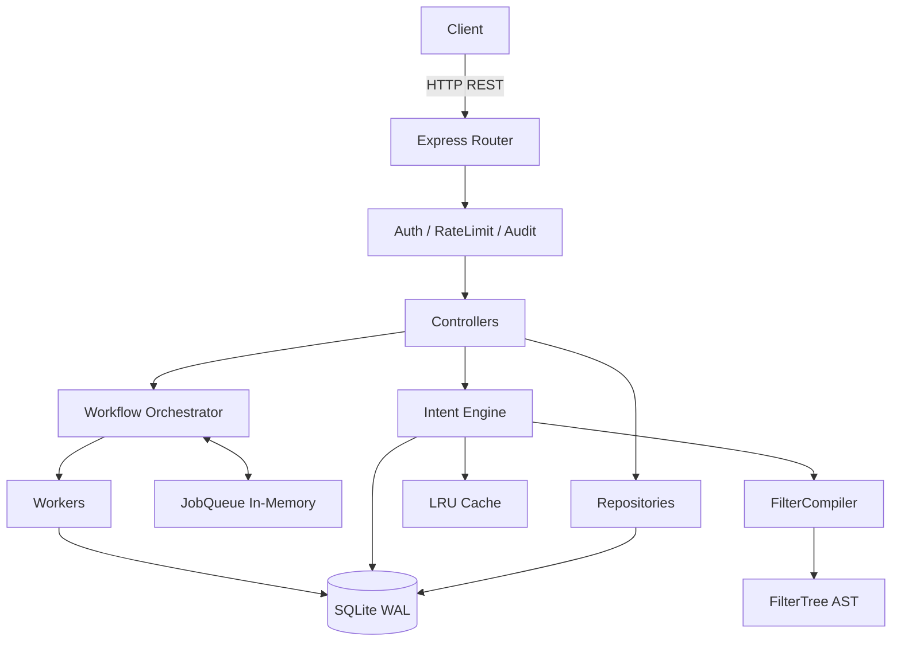

# RetailPulse

Backend automation platform for a retail business. Built with Node.js, Express, and SQLite.

## Features
- Fast CSV streaming ingestion
- Job orchestrator with priority queue and state machine
- Intent engine for resolving complex JSON filters into safe parameterized SQL
- LRU caching for repeated queries
- API key authentication with roles, rate limiting, and audit logging

## Architecture


## Setup & Run

1. **Install dependencies:**
   `npm install`

2. **Initialize Database:**
   `npm run db:init`

3. **Generate Sample Data (Optional, creates 200k+ rows):**
   `npm run seed`

4. **Start Development Server:**
   `npm run dev`

5. **Run Tests:**
   `npm test`
   `npm run test:coverage`

## API Examples

Get Health:
```bash
curl http://localhost:3000/api/v1/health
```

List Products (Requires read or admin key):
```bash
curl -H "x-api-key: dev-read-key-change-me" http://localhost:3000/api/v1/products
```

Execute an Intent:
```bash
curl -X POST -H "Content-Type: application/json" -H "x-api-key: dev-read-key-change-me" -d '{
  "intent": "low_stock",
  "params": {
    "limit": 10
  }
}' http://localhost:3000/api/v1/intents/execute
```

Create a Job (Requires admin key):
```bash
curl -X POST -H "Content-Type: application/json" -H "x-api-key: dev-admin-key-change-me" -d '{
  "type": "DAILY_REPORT",
  "payload": { "date": "2024-01-01" }
}' http://localhost:3000/api/v1/jobs
```
