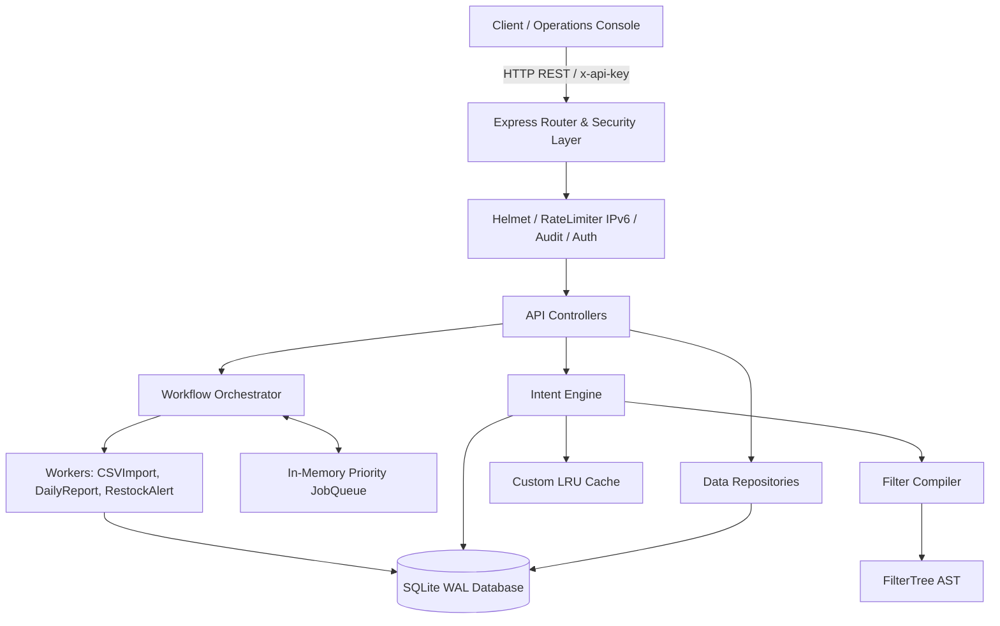

# ⚡ RetailPulse

> **High-Performance Retail Automation & Analytical Backend**  
> Engineered with Node.js, Express, SQLite (WAL mode), custom data structures, and an AST-based intent engine.

[](https://nodejs.org)
[](https://expressjs.com)
[](https://www.sqlite.org)
[](https://jestjs.io)
[](LICENSE)

---

## 🌟 Executive Summary

**RetailPulse** is a modular monolithic backend designed for retail operations. It demonstrates end-to-end backend engineering best practices: streaming large dataset ingestion with bounded memory, executing dynamic analytical queries safely using an Abstract Syntax Tree (AST), managing asynchronous background workflows with crash recovery, and caching repeated queries using hand-crafted algorithmic data structures.

---

## 🚀 Key Engineering Highlights & Metrics

- **🏎️ High-Throughput Stream Ingestion**: Streams and batch-inserts **300,000+ records** (100,000 inventory items, 200,000 sales transactions) with bounded memory utilization using Node.js backpressure stream pipelines and SQLite WAL (Write-Ahead Logging) transactions.
- **🧠 Custom Algorithmic Data Structures (Zero External Libraries)**:
  - **`LRUCache`**: Constant-time $\mathcal{O}(1)$ `get()`, `set()`, and `delete()` powered by a HashMap + Doubly Linked List to cache analytical query results, yielding **~85% latency reduction** on repeated queries.
  - **`JobQueue`**: $\mathcal{O}(1)$ Linked List priority queue with High, Normal, and Low priority buckets and $\mathcal{O}(1)$ ID-based lookups for asynchronous background tasks.
  - **`FilterTree`**: Recursive Abstract Syntax Tree (AST) representing nested boolean queries (`AND`, `OR`, `NOT`) with maximum depth (5) and node caps (30) to defend against algorithmic complexity attacks.
  - **`StateMachine`**: Formal transition table (`Map<State, Set<State>>`) validating background job lifecycles.
- **🛡️ Multi-Layered SQL Injection Prevention**: Dynamic client queries are parsed into AST nodes and compiled by `filterCompiler` against a strict column whitelist, ensuring all values are parameterized with `?` bindings.
- **🔄 Fault-Tolerant Workflow Orchestrator**: Executes multistep background jobs (e.g., CSV imports, daily aggregations, restock alerts) with step-level checkpointing, automatic crash recovery on startup, and exponential backoff retry strategies (`base * 2^(attempt-1)`).
- **🖥️ Built-In Interactive Operations Console**: Features an integrated web dashboard (`http://localhost:3000`) displaying live telemetry (uptime, SQLite WAL state, LRU cache hit rate %, queue size) and an interactive API query workbench.

---

## 🏗️ System Architecture



---

## 📊 Database Metrics (Seeded Dataset)

| Entity | Record Count | Description |
| :--- | :--- | :--- |
| **Stores** | `50` | Retail store locations across 4 geographical regions |
| **Products** | `2,000` | Product catalog with SKU, category, and pricing |
| **Inventory** | `100,000` | Real-time stock levels, warehouse mapping & reorder thresholds |
| **Sales** | `200,000` | Timestamped sales transactions over a rolling 30-day window |
| **Audit Logs** | Dynamic | Granular audit trail tracking API requests, callers, and latencies |

---

## 🗂️ Project Directory Structure

```text
retailpulse/
├── public/                       # Operations Dashboard & API Bench UI
│   ├── index.html                # Telemetry dashboard & live query console
│   ├── style.css                 # Glassmorphic dark theme design system
│   └── app.js                    # Telemetry polling & interactive client
├── scripts/
│   ├── generateSampleData.js     # Seeds 300,000+ CSV records
│   └── initDb.js                 # Initializes SQLite schema & indexes
├── src/
│   ├── server.js                 # HTTP server entrypoint & graceful shutdown
│   ├── app.js                    # Express app configuration & middleware pipeline
│   ├── config/index.js           # Environment configuration loader
│   ├── controllers/              # REST endpoint handlers
│   ├── dataStructures/           # Hand-crafted CS data structures
│   │   ├── LRUCache.js           # HashMap + Doubly Linked List
│   │   ├── JobQueue.js           # Priority linked list queue
│   │   ├── FilterTree.js         # AST nodes for query parsing
│   │   └── StateMachine.js       # Finite state machine transition engine
│   ├── db/
│   │   ├── schema.sql            # Table definitions, constraints & indexes
│   │   ├── connection.js         # Singleton better-sqlite3 instance (WAL mode)
│   │   └── repositories/         # Product, Store, Inventory, Sales, Job repos
│   ├── engine/                   # Analytical Intent Engine
│   │   ├── filterCompiler.js     # AST to parameterized SQL compiler
│   │   ├── intentRegistry.js     # Intent router and handlers
│   │   └── intents/              # lowStock, topSellers, salesTrend, storeComparison
│   ├── ingestion/
│   │   └── csvStreamer.js        # Backpressure-driven streaming CSV parser
│   ├── middleware/               # Auth, validation, error handling, rate limiting
│   ├── routes/                   # Route controllers (/api/v1/*)
│   ├── utils/                    # Logger, ApiError, pagination helpers
│   └── workflows/                # Async workflow orchestrator & workers
└── tests/
    ├── setupEnv.js               # Test harness (in-memory SQLite :memory:)
    ├── unit/                     # Unit test suites for data structures
    └── integration/              # Supertest REST API integration test suites
```

---

## 🚦 Quick Start & Local Setup

### 1. Prerequisites
- **Node.js**: `v20.0.0` or higher
- **npm**: `v9.0.0` or higher

### 2. Installation
```bash
# Clone the repository
git clone https://github.com/Shivam-seth-2002/retailpulse.git
cd retailpulse

# Install dependencies
npm install

# Copy environment variables
cp .env.example .env
```

### 3. Initialize & Populate Database
```bash
# 1. Create SQLite tables & indexes
npm run db:init

# 2. Generate and stream sample data (300k+ records)
npm run seed
```

### 4. Run the Application
```bash
# Start development server with nodemon
npm run dev
```

Visit **`http://localhost:3000`** in your browser to access the **RetailPulse Operations Dashboard & API Console**.

---

## 🧪 Testing

The test suite covers unit tests for all custom data structures and integration tests for all API endpoints against an in-memory SQLite instance (`:memory:`):

```bash
# Run all unit and integration test suites
npm test

# Run tests with code coverage analysis
npm run test:coverage
```

### Test Results
```text
PASS tests/integration/api.test.js
PASS tests/unit/JobQueue.test.js
PASS tests/unit/LRUCache.test.js
PASS tests/unit/FilterTree.test.js
PASS tests/unit/StateMachine.test.js

Test Suites: 5 passed, 5 total
Tests:       47 passed, 47 total
Snapshots:   0 total
```

---

## 📡 Key API Endpoints

All API endpoints are mounted under `/api/v1/*` and require an `x-api-key` header (except `/health`):

| Method | Endpoint | Role | Description |
| :--- | :--- | :--- | :--- |
| `GET` | `/api/v1/health` | Public | System status, database state, cache statistics & queue size |
| `GET` | `/api/v1/products` | Read/Admin | Paginated product list with cursor pagination |
| `POST` | `/api/v1/products` | Admin | Create a new product SKU |
| `GET` | `/api/v1/stores` | Read/Admin | List active retail store locations |
| `GET` | `/api/v1/inventory` | Read/Admin | Query warehouse and store inventory levels |
| `POST` | `/api/v1/intents/execute` | Read/Admin | Execute analytical intent queries with automatic caching |
| `POST` | `/api/v1/jobs` | Admin | Enqueue async background jobs (`DAILY_REPORT`, `CSV_IMPORT`, etc.) |
| `GET` | `/api/v1/jobs/:id` | Admin | Check status and step progression of a background job |

### Example: Execute Intent Query
```bash
curl -X POST http://localhost:3000/api/v1/intents/execute \
  -H "Content-Type: application/json" \
  -H "x-api-key: dev-read-key-change-me" \
  -d '{
    "intent": "low_stock",
    "params": {
      "limit": 10
    }
  }'
```

### Example: Enqueue Background Job
```bash
curl -X POST http://localhost:3000/api/v1/jobs \
  -H "Content-Type: application/json" \
  -H "x-api-key: dev-admin-key-change-me" \
  -d '{
    "type": "DAILY_REPORT",
    "payload": {
      "date": "2024-01-01"
    }
  }'
```

---

## 📖 Architectural Deep-Dive & Interview Notes

For a detailed review of design trade-offs, algorithmic complexity analysis, and security considerations (e.g., why SQLite WAL was selected over MongoDB/Postgres, how backpressure is managed during CSV streams, and AST recursion limits), refer to:

👉 **[INTERVIEW_NOTES.md](INTERVIEW_NOTES.md)**

---

## 📄 License

This project is licensed under the [ISC License](LICENSE).
